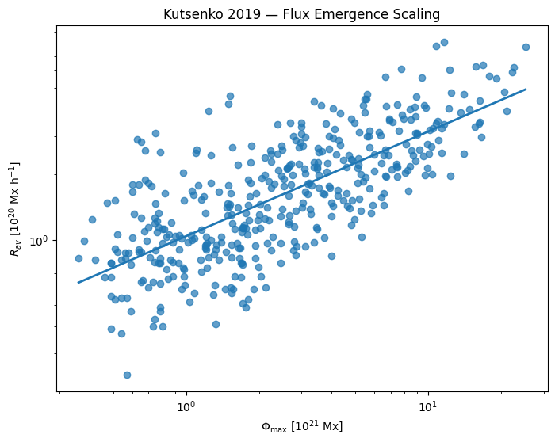
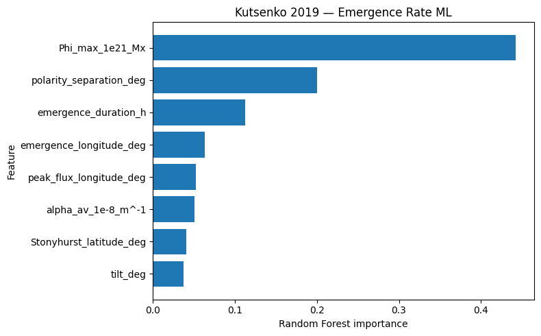
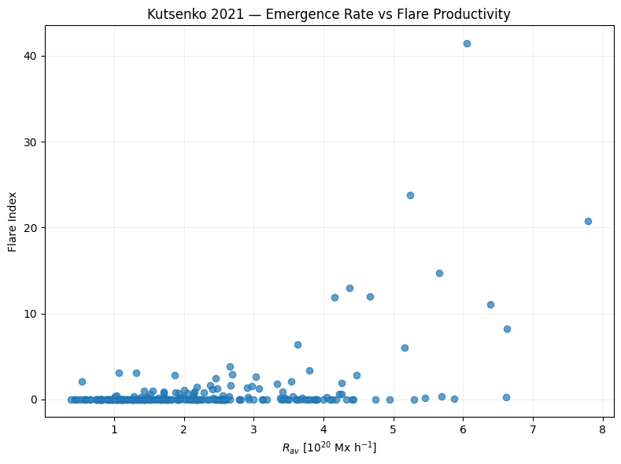
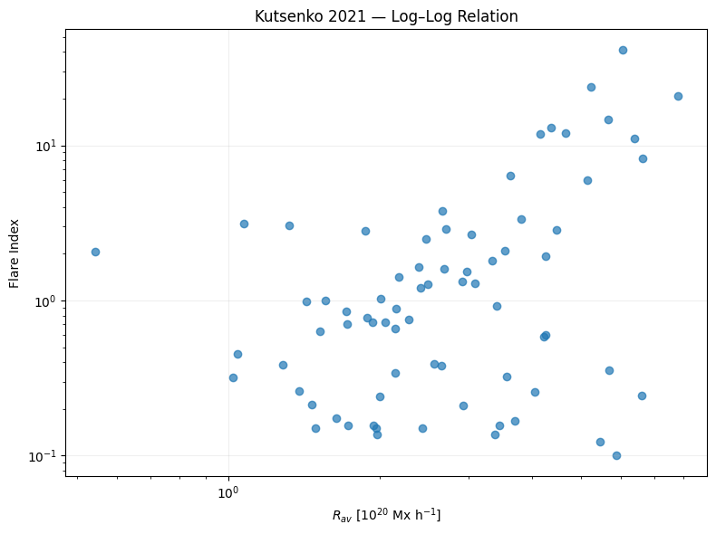
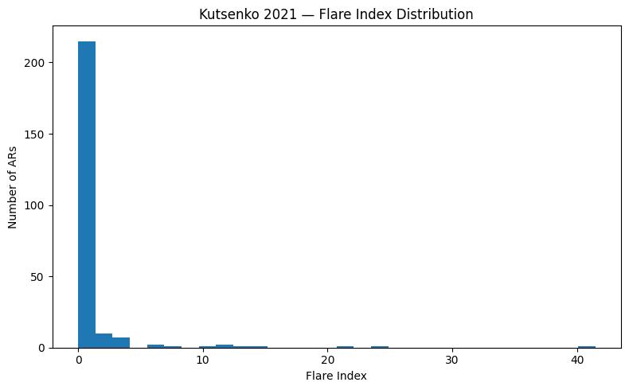
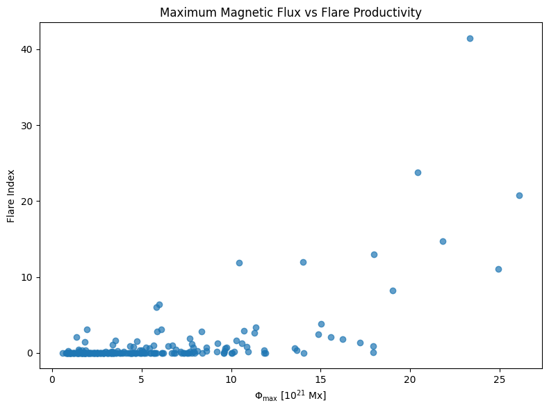
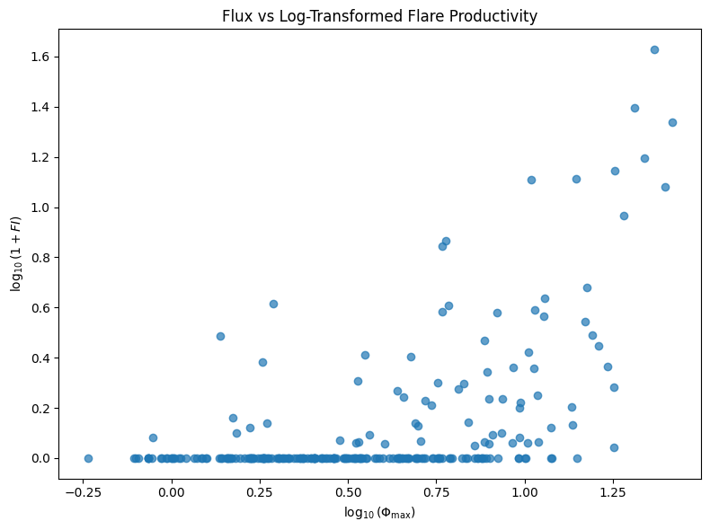
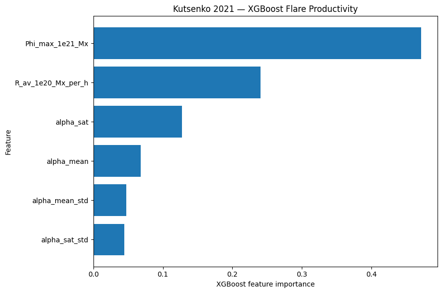
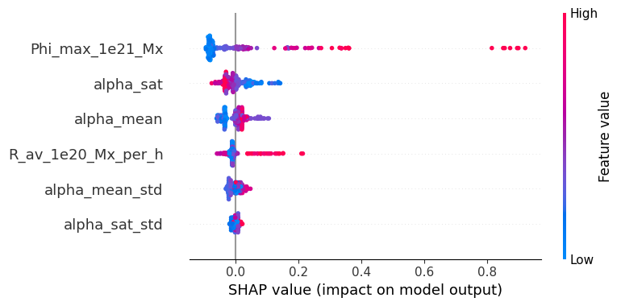
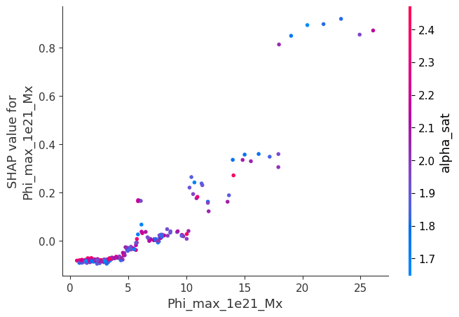

# Physics-Informed ML for Solar Active Regions & Flare Productivity

**Canonical analysis:** `notebooks/flare-ml-kutsenko-2019-2021.ipynb`

This repository packages the user's executed **Kaggle Kutsenko 2019/2021 notebook** into a reproducible GitHub project. The notebook is the authoritative computational record; the result tables and report preserve its actual outputs.

## Executive result

The completed study shows:

- **423** Kutsenko 2019 emerging-AR rows / **406 unique HARPs**
- **243** Kutsenko 2021 rows / **235 unique HARPs**
- Gradient Boosting: **5-fold CV R2 = 0.9169** for 2019 emergence-rate prediction
- 2019 emergence-duration ablation: **R2 = 0.9315**
- `R_av × emergence_duration` vs `Phi_max`: **Spearman rho = 0.999982**
- `Phi_max` flare classifier: **ROC-AUC = 0.8242, PR-AUC = 0.5977**
- Fair XGBoost continuous flare regression: **Phi_max-only CV R2 = 0.5435**
- 20-repeat CV: Phi_max-only mean R2 = **0.4993**
- OOF permutation importance: Phi_max = **0.7607**

## Most important scientific interpretation

The project does **not** claim that adding more variables automatically reveals more physics.

A particularly important finding is that emergence duration almost perfectly reconstructs the flux scale when combined with emergence rate:

`Phi_max ≈ R_av × emergence_duration`

with Spearman rho **0.999982**.

Therefore the very high 2019 ML performance when duration is included is largely recovering the underlying emergence-rate/flux-duration relationship, not proving that duration independently causes stronger emergence.

For flare productivity, maximum unsigned flux is the strongest aggregate predictor in the completed catalogue benchmark. Alpha variables are used by XGBoost and show interactions, but they do not improve the controlled continuous-regression CV score beyond Phi_max alone.

## Repository

```text
solar-ar-kutsenko-ml/
├── README.md
├── METHODOLOGY.md
├── PROJECT_ROADMAP.md
├── LICENSE
├── requirements.txt
├── data/
│   └── README.md
├── notebooks/
│   └── flare-ml-kutsenko-2019-2021.ipynb   ← canonical Kaggle notebook
├── scripts/
│   ├── 01_kutsenko2019_scaling.py
│   ├── 02_kutsenko2021_classification.py
│   ├── 03_kutsenko2021_regression.py
│   └── 04_model_interpretation.py
├── src/
│   └── utils.py
├── results/
│   ├── classification_results.csv
│   ├── regression_results.csv
│   ├── xgb_feature_importance.csv
│   ├── shap_importance.csv
│   ├── permutation_importance.csv
│   ├── shap_interactions.csv
│   └── KAGGLE_NOTEBOOK_EXACT_RESULTS.md
└── figures/
    └── README.md
```


## Visual results

The key figures below are extracted directly from the executed Kaggle notebook. The complete figure set is available in [`figures/`](figures/).

### Figure 1



### Figure 2



### Figure 3



### Figure 4



### Figure 5



### Figure 6



### Figure 7



### Figure 8



### Figure 9



### Figure 10



## Scientific references

- Kutsenko et al. (2019), *Extended statistical analysis of emerging solar active regions*: https://doi.org/10.1093/mnras/stz308
- Kutsenko et al. (2021), *On the possibility of probing the flare productivity of an active region in the early stage of emergence*: https://doi.org/10.1093/mnras/staa3548
- Kutsenko, Abramenko & Plotnikov (2024), *A Statistical Study of Magnetic Flux Emergence in Solar Active Regions Prior to Strongest Flares*: https://doi.org/10.1088/1674-4527/ad2e4d
- Energy/helicity-flux methodology used in the SHARP extension: https://doi.org/10.1088/0004-637X/806/2/245

## Reproduction

The exact current results are tied to the original Kaggle notebook and its mounted Kaggle dataset inputs.

For local experimentation:

```bash
pip install -r requirements.txt
```

Then run the canonical notebook in Jupyter/Kaggle.

The CSVs under `results/` are preserved outputs from the executed notebook. Files named `*_recomputed.csv` are generated by the standalone scripts and may differ slightly depending on the exact preprocessing/environment.

## Next phase

The notebook already begins Phase III: discovery/audit of SHARP/emerging-AR time-series files.

The scientific upgrade is:

```text
early SHARP time series
        ↓
feature engineering
        ↓
future flare/CME labels
        ↓
HARP-grouped validation
        ↓
6/12/24/48 h forecasting
```

No feature after the forecast cutoff should enter a prediction snapshot.

## CV-ready title

**Physics-Informed Machine Learning for Solar Active Regions and Flare Productivity**

This is a strong Data Science portfolio project because it demonstrates scientific data cleaning, statistical modelling, feature engineering, cross-validation, classification, regression, XGBoost, SHAP, permutation importance, feature ablation and leakage-aware forecasting design.
