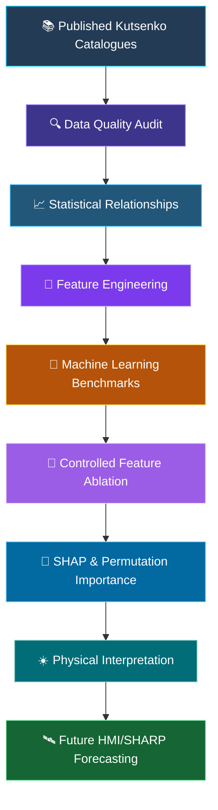
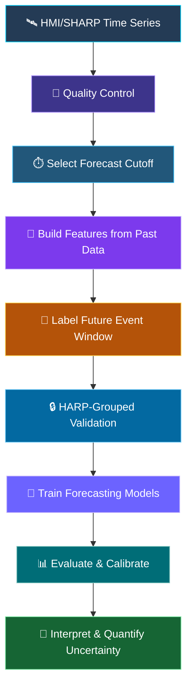

<div align="center">


# ☀️ Physics-Informed Machine Learning for Solar Active Regions

### From magnetic-flux emergence to flare productivity

A scientific machine-learning project investigating the relationship between emerging solar active-region properties and flare productivity using published Kutsenko catalogues, statistical analysis, controlled feature ablation, and explainable AI.

<br/>


<br/><br/>

<a href="https://github.com/shubham-k-jha/solar-ar-kutsenko-ml">

</a>
<a href="notebooks/flare-ml-kutsenko-2019-2021.ipynb">

</a>
<a href="METHODOLOGY.md">

</a>

</div>

---

## 🔭 Research Overview

Solar active regions emerge and evolve through magnetic-flux emergence, polarity separation, and changes in magnetic-field structure. Some regions produce powerful solar flares, while others remain comparatively quiet.

This project investigates a central question:

> **How much can measurable properties of emerging solar active regions explain magnetic-flux emergence and flare productivity, and which features provide useful predictive information beyond correlated physical quantities?**

The research combines solar physics, statistical analysis, machine learning, and model interpretation.

<div align="center">

<table>
<tr>
<td align="center" width="33%">


### 📡 Catalogue Analysis

<sub>Published active-region measurements and scientific relationships</sub>

</td>
<td align="center" width="33%">


### 🤖 Machine Learning

<sub>Emergence-rate modelling and flare-productivity prediction</sub>

</td>
<td align="center" width="33%">


### 🔬 Explainability

<sub>Feature ablation, SHAP, permutation importance, and physical interpretation</sub>

</td>
</tr>
</table>

</div>

### 🧭 Research pipeline



---

## 🎯 Research Objectives

| Objective | Scientific question |
|---|---|
| **Emergence physics** | How are maximum magnetic flux, emergence rate, duration, and polarity separation related? |
| **Flare productivity** | Can active-region properties distinguish flare-productive from non-productive regions? |
| **Continuous prediction** | Can a model estimate the magnitude of flare productivity instead of only predicting a class? |
| **Feature independence** | Do additional features contribute independent predictive information? |
| **Explainable ML** | Are the model's important features consistent with the underlying physical relationships? |
| **Future forecasting** | Can time-resolved HMI/SHARP observations predict events that occur after a defined forecast cutoff? |

---

## 📚 Scientific Foundation

The project builds on published research by Kutsenko and collaborators.

| Reference | Role in this project |
|---|---|
| Kutsenko et al. (2019) | Magnetic-flux emergence and emergence-rate scaling |
| Kutsenko et al. (2021) | Relationships between emerging-region properties and flare productivity |
| Kutsenko, Abramenko & Plotnikov (2024) | Statistical context for emerging active regions and strong flares |
| ApJ 806, 245 | Energy- and helicity-flux methodology relevant to the planned SHARP extension |

### Papers

- [Kutsenko et al. (2019) — MNRAS](https://doi.org/10.1093/mnras/stz308)
- [Kutsenko et al. (2021) — MNRAS](https://doi.org/10.1093/mnras/staa3548)
- [Kutsenko, Abramenko & Plotnikov (2024)](https://doi.org/10.1088/1674-4527/ad2e4d)
- [Energy/helicity-flux methodology — ApJ](https://doi.org/10.1088/0004-637X/806/2/245)

---

## 🗂️ Dataset Overview

The current analysis uses two published catalogues. The counts and summary statistics below are reported by the existing project documentation.

<div align="center">

<table>
<tr>
<td align="center" width="50%">


### Kutsenko 2019

**406 unique HARPs**

<sub>Emergence-rate and magnetic-flux analysis</sub>

</td>
<td align="center" width="50%">


### Kutsenko 2021

**235 unique HARPs**

<sub>Flare-productivity analysis</sub>

</td>
</tr>
</table>

</div>

### Kutsenko 2019 catalogue

| Quantity | Reported value |
|---|---:|
| Catalogue rows | 423 |
| Unique HARPs | 406 |
| Kappa | 0.48114 |
| Polarity-separation exponent | 0.36159 |

Important variables include:

- `Phi_max` — maximum unsigned magnetic flux
- `R_av` — average magnetic-flux emergence rate
- Emergence duration
- Polarity separation
- Tilt
- Latitude and longitude
- Magnetic-field parameters

### Kutsenko 2021 catalogue

| Quantity | Reported value |
|---|---:|
| Catalogue rows | 243 |
| Unique HARPs | 235 |
| Flare-productive regions | 34 |
| Non-productive regions | 209 |
| Mean flare index | 0.95973 |
| Maximum flare index | 41.4636 |

**Important:** The relatively small number of flare-productive regions makes uncertainty, class imbalance, and validation strategy central to interpreting the reported results.

---

## 📈 Experiment 1 — Magnetic-Flux Emergence Rate

The first experiment predicts average emergence rate from active-region properties.

### Model benchmark

<text color="secondary" size="sm">Reported results from the existing analysis</text>

| Model | R² | MAE | RMSE |
|---|---:|---:|---:|
| Kutsenko power law | 0.599 | 0.575 | 0.787 |
| Linear Regression | 0.827 | 0.411 | 0.516 |
| Random Forest | 0.726 | 0.487 | 0.650 |
| **Gradient Boosting** | **0.924** | **0.182** | **0.341** |

### Five-fold cross-validation

<div align="center">

<table>
<tr>
<td align="center" width="33%">

<text color="#6C63FF" size="sm">CV R²</text>

# 0.9169

</td>
<td align="center" width="33%">

<text color="#0891B2" size="sm">MAE</text>

# 0.1896

</td>
<td align="center" width="33%">

<text color="#16A34A" size="sm">RMSE</text>

# 0.3734

</td>
</tr>
</table>

</div>

Reported standard deviation of cross-validation R²: **0.0214**.

These results indicate a strong relationship between the catalogue features and emergence rate under the existing modelling setup. They do not, by themselves, demonstrate forecasting performance on unseen active regions or future observations.

---

## 🧪 Critical Experiment — Emergence Duration and Feature Dependence

One of the most important findings comes from controlled feature ablation.

### Reported ablation results

| Feature set | CV R² |
|---|---:|
| `Phi` only | 0.473 |
| `Phi + separation` | 0.465 |
| **`Phi + separation + duration`** | **0.932** |
| All features | 0.917 |

Adding emergence duration produces a large increase in the reported cross-validation score. But a high score does not automatically mean that the model has discovered an independent physical effect.

### The physical relationship

The existing notebook reports an almost perfect Spearman correlation between the relevant quantities:

<div align="center">


</div>

The relationship under investigation is:

\[
\Phi_{\max}\approx R_{\mathrm{av}}\times t_{\mathrm{emergence}}
\]

This suggests that emergence duration carries information closely related to the underlying flux-emergence relationship.

**Scientific interpretation:** The improvement could reflect a mathematical or physical dependency among features rather than a new, independent causal predictor.

This is why feature ablation must be accompanied by physical reasoning, correlation analysis, and careful interpretation.

---

## 🔥 Experiment 2 — Flare Productivity

The second experiment investigates whether properties of emerging active regions can distinguish flare-productive regions from non-productive ones.

### Statistical relationships

| Relationship | Reported result |
|---|---:|
| Pearson correlation: `R_av` vs flare index | 0.4742 |
| Spearman correlation: `R_av` vs flare index | 0.3805 |

### Emergence rate by productivity group

| Statistic | Productive regions | Non-productive regions |
|---|---:|---:|
| Median `R_av` | 3.056 | 1.778 |
| Mean `R_av` | 3.514 | 2.063 |

The reported statistics show higher emergence rates among flare-productive regions in this catalogue.

However, differences between group averages do not establish causation, and the degree of overlap between the groups remains important when assessing predictive utility.

---

## 🎯 Binary Classification

The classification task predicts whether an active region belongs to the flare-productive group.

### Baseline

<div align="center">

<table>
<tr>
<td align="center" width="33%">

<text color="#6C63FF" size="sm">ROC-AUC</text>

# 0.7618

</td>
<td align="center" width="33%">

<text color="#0891B2" size="sm">PR-AUC</text>

# 0.4154

</td>
<td align="center" width="33%">

<text color="#16A34A" size="sm">Brier score</text>

# 0.1939

</td>
</tr>
</table>

</div>

### Controlled feature ablation

| Features | ROC-AUC | PR-AUC | Brier |
|---|---:|---:|---:|
| **`Phi` only** | **0.8242** | **0.5977** | 0.1500 |
| All features | 0.8051 | 0.5877 | **0.1496** |
| `Phi + R_av` | 0.8175 | 0.5823 | 0.1512 |
| `R_av + alpha` | 0.7872 | 0.4482 | 0.1842 |
| `R_av + alpha uncertainty` | 0.7706 | 0.4452 | 0.1851 |
| `R_av` only | 0.7618 | 0.4154 | 0.1939 |

### Main result

<div align="center">


</div>

In the reported comparison, maximum unsigned magnetic flux alone performs better than the all-feature configuration on ROC-AUC and PR-AUC.

That result supports investigating magnetic flux as a strong aggregate signal in this dataset. It does not prove that flux alone is sufficient for operational forecasting.

**Metric caution:** PR-AUC depends on class prevalence and on the convention used to calculate it. Comparisons should use the same validation folds, baseline definition, and scoring implementation.

---

## 📊 Experiment 3 — Continuous Flare-Productivity Prediction

Binary classification and continuous regression answer different questions.

The regression experiment predicts:

\[
y=\log_{10}(\mathrm{flare\ index})
\]

### Reported model comparison

| Model | CV R² |
|---|---:|
| `Phi_max` only | 0.176 |
| Multivariate Linear Regression | 0.317 |
| Random Forest | 0.363 |
| **XGBoost** | **0.405** |

The reported general nonlinear benchmark reaches a cross-validation R² of **0.405**.

### Controlled XGBoost feature ablation

The same model family and reported validation procedure are compared across feature sets.

| Features | CV R² | R² std | MAE | RMSE |
|---|---:|---:|---:|---:|
| **`Phi_max` only** | **0.5435** | 0.0623 | **0.1028** | **0.1771** |
| `Phi_max + R_av` | 0.4418 | 0.1433 | 0.1134 | 0.1915 |
| All features | 0.4051 | 0.2389 | 0.1165 | 0.1913 |
| `Phi + R_av + alpha` | 0.3999 | 0.2324 | 0.1140 | 0.1926 |
| `R_av` only | 0.0574 | 0.1834 | 0.1514 | 0.2508 |

### Repeated five-fold cross-validation

| Model | Mean R² | Std | Median | Minimum | Maximum |
|---|---:|---:|---:|---:|---:|
| **`Phi_max` only** | **0.4993** | 0.2315 | 0.5538 | -0.9691 | 0.8166 |
| `Phi_max + R_av` | 0.4009 | 0.3136 | 0.4740 | -1.4673 | 0.7835 |
| All features | 0.3843 | 0.2953 | 0.4669 | -1.2055 | 0.7828 |

The wide spread across repeated validation splits highlights uncertainty associated with the small catalogue and limited number of flare-productive regions.

The controlled ablation also shows that **adding more features does not necessarily improve generalization**.

---

## 🔬 Explainable Machine Learning

The project compares multiple interpretation methods to investigate which variables drive the model's predictions.

### XGBoost feature importance

| Feature | Reported importance |
|---|---:|
| **`Phi_max`** | **0.4716** |
| `R_av` | 0.2408 |
| `alpha_sat` | 0.1275 |
| `alpha_mean` | 0.0684 |
| `alpha_mean_std` | 0.0473 |
| `alpha_sat_std` | 0.0443 |

### SHAP importance

| Feature | Mean absolute SHAP |
|---|---:|
| **`Phi_max`** | **0.1059** |
| `alpha_sat` | 0.0290 |
| `alpha_mean` | 0.0256 |
| `R_av` | 0.0226 |
| `alpha_mean_std` | 0.0142 |
| `alpha_sat_std` | 0.0064 |

### Out-of-fold permutation importance

| Feature | Reported mean importance |
|---|---:|
| **`Phi_max`** | **0.7607** |
| `alpha_mean` | 0.0298 |
| `alpha_sat` | 0.0270 |
| `alpha_mean_std` | 0.0058 |
| `R_av` | -0.0116 |
| `alpha_sat_std` | -0.0161 |

<div align="center">


</div>

### What do these results mean?

The three methods provide complementary evidence:

- **Model feature importance** summarizes how a fitted tree model uses features under its particular importance definition.
- **SHAP** attributes predictions to input features relative to a chosen background/reference distribution.
- **Permutation importance** measures the impact of disrupting a feature on a chosen evaluation score.

The reported agreement around `Phi_max` strengthens the case that magnetic flux is the dominant aggregate signal in the current analysis.

Negative permutation importance does not mean a feature has negative physical importance. It means that, under the reported evaluation procedure, permuting that feature did not improve the measured score and may have improved it.

Correlated features can also complicate all three interpretation methods.

---

## 🧩 SHAP Interaction Analysis

The existing analysis reports the following strongest interaction strengths.

| Feature pair | Mean absolute interaction |
|---|---:|
| `R_av × alpha_sat` | 0.00601 |
| `Phi_max × alpha_sat` | 0.00595 |
| `Phi_max × alpha_mean` | 0.00440 |
| `Phi_max × R_av` | 0.00337 |
| `R_av × alpha_mean` | 0.00162 |

These values describe interactions learned by the model. They are **not proof of causal physical interactions** between the corresponding solar quantities.

Physical interpretation requires additional analysis, appropriate controls, and independent evidence.

---

## 🖼️ Visual Results

The original README identifies these images as figures extracted from the executed Kaggle notebook and stored in `figures/`.

### 1. Emergence and scaling

<div align="center">

<table>
<tr>
<td width="50%" align="center">


</td>
<td width="50%" align="center">


</td>
</tr>
</table>

</div>

### 2. Flare productivity

<div align="center">

<table>
<tr>
<td width="50%" align="center">


</td>
<td width="50%" align="center">


</td>
</tr>
</table>

</div>

### 3. Machine-learning benchmarks

<div align="center">

<table>
<tr>
<td width="50%" align="center">


</td>
<td width="50%" align="center">


</td>
</tr>
<tr>
<td width="50%" align="center">


</td>
<td width="50%" align="center">


</td>
</tr>
</table>

</div>

### 4. Explainable AI — SHAP

<div align="center">

<table>
<tr>
<td width="50%" align="center">


</td>
<td width="50%" align="center">


</td>
</tr>
<tr>
<td width="50%" align="center">


</td>
<td width="50%" align="center">


</td>
</tr>
<tr>
<td width="50%" align="center">


</td>
<td width="50%" align="center">

</td>
</tr>
</table>

</div>

For the full figure set and notebook-cell provenance, see [`figures/README.md`](figures/README.md).

---

## ☀️ Main Scientific Takeaways

<div align="center">

<table>
<tr>
<td width="50%" valign="top">

### 01 · Magnetic flux dominates

`Phi_max` consistently provides the strongest reported aggregate predictive signal across the classification benchmark and several interpretation methods.

</td>
<td width="50%" valign="top">

### 02 · Features are not independent

Magnetic flux, emergence rate, and emergence duration are related. Models may exploit these dependencies instead of discovering new independent predictors.

</td>
</tr>
<tr>
<td width="50%" valign="top">

### 03 · More features are not always better

In the controlled regression experiment, the `Phi_max`-only XGBoost configuration outperforms the larger feature sets.

</td>
<td width="50%" valign="top">

### 04 · Prediction tasks differ

A feature can help distinguish productive regions without accurately estimating the magnitude of their flare productivity.

</td>
</tr>
</table>

</div>

### A central statistical relationship

The reported Spearman correlation between `Phi_max` and `R_av` is approximately:

\[
\rho_{\mathrm{Spearman}}\approx0.672
\]

The existing analysis suggests that `R_av` provides some value for binary discrimination, but its incremental contribution to continuous regression becomes weak after including `Phi_max`.

These conclusions are specific to the current catalogue, feature definitions, models, and validation setup.

---

## ⚠️ Limitations and Validation Risks

A retrospective catalogue model is not automatically a forecasting model.

| Limitation | Why it matters |
|---|---|
| Small productive sample | Only 34 flare-productive regions are reported in the 2021 catalogue. |
| Correlated predictors | Feature importance may be shared or redistributed among related variables. |
| Aggregate features | Maximum flux may summarize information from an entire region's evolution. |
| Random validation | Related observations may appear in both training and testing if grouping is not enforced. |
| Retrospective labels | Catalogue productivity does not necessarily represent a defined future forecasting horizon. |
| Model interpretation | SHAP and permutation importance do not establish causality. |
| Score variability | Negative R² values in repeated splits indicate unstable out-of-sample regression performance on some splits. |

**Research standard:** The reported scores should be reproduced from the canonical notebook, and validation should be checked for active-region overlap and feature leakage before claiming generalization.

---

## 🛰️ Next Stage — HMI/SHARP Forecasting

The next research stage is to move from completed active-region catalogue summaries toward **time-resolved observations and explicitly future-oriented targets**.

### From retrospective analysis to forecasting



### Candidate time-dependent features

The proposed extension may investigate:

- Magnetic flux \(\Phi(t)\)
- Energy-flux measurements
- Helicity-flux measurements
- Normalized helicity measures
- Temporal derivatives and change rates
- Rolling-window statistics and variability
- Pre-event magnetic evolution

These are proposed features for the future stage, not a claim that they are already implemented in the current catalogue experiments.

### Forecast horizons

- 6 hours
- 12 hours
- 24 hours
- 48 hours

The forecasting dataset must enforce:

\[
t_{\mathrm{feature}}\leq t_{\mathrm{cutoff}}
\]

The target event must occur **after** the cutoff and within the explicitly defined forecast window.

### Validation requirements

- Split by HARP or active region to prevent group leakage.
- Fit preprocessing and feature selection only on training data.
- Compare against simple, well-defined baselines.
- Evaluate ROC-AUC and PR-AUC for classification.
- Assess probability calibration and Brier score.
- Report uncertainty and performance variability.
- Test generalization across time periods and solar-cycle conditions.

---

## 🧪 Reproducibility

The existing README identifies the executed Kaggle notebook as the canonical computational record:

[`notebooks/flare-ml-kutsenko-2019-2021.ipynb`](notebooks/flare-ml-kutsenko-2019-2021.ipynb)

Standalone analysis scripts are organized as follows:

```text
scripts/
├── 01_kutsenko2019_scaling.py
├── 02_kutsenko2021_classification.py
├── 03_kutsenko2021_regression.py
└── 04_model_interpretation.py
```

### Kaggle and local data paths

The documented notebook checks for the Kaggle dataset mount and falls back to a local data directory.

```python
from pathlib import Path

KAGGLE_KUTSENKO = Path("/kaggle/input/datasets/sj3267/kutsenko")
LOCAL_DATA = Path("../data")

DATA_DIR = (
    KAGGLE_KUTSENKO
    if KAGGLE_KUTSENKO.exists()
    else LOCAL_DATA
)
```

Confirm that the expected files exist under `DATA_DIR` before loading the data.

### Recommended reproduction checks

1. Confirm the source files and catalogue row counts.
2. Reproduce the statistical summaries.
3. Re-run the model benchmarks and feature-ablation experiments.
4. Verify that the same splits and scoring definitions are used for comparisons.
5. Reproduce SHAP and permutation-importance results.
6. Confirm the generated figures match the reported tables.
7. Record dependency versions, random seeds, and any differences between local and Kaggle execution.

---

## 📁 Repository Structure

```text
solar-ar-kutsenko-ml/
│
├── README.md
├── METHODOLOGY.md
├── PROJECT_ROADMAP.md
├── LICENSE
├── requirements.txt
│
├── data/
│   └── README.md
│
├── notebooks/
│   └── flare-ml-kutsenko-2019-2021.ipynb
│
├── scripts/
│   ├── 01_kutsenko2019_scaling.py
│   ├── 02_kutsenko2021_classification.py
│   ├── 03_kutsenko2021_regression.py
│   └── 04_model_interpretation.py
│
├── src/
│   └── utils.py
│
├── results/
│   ├── classification_results.csv
│   ├── regression_results.csv
│   ├── repeated_cv.csv
│   ├── shap_importance.csv
│   ├── shap_interactions.csv
│   ├── permutation_importance.csv
│   └── KAGGLE_NOTEBOOK_EXACT_RESULTS.md
│
└── figures/
    └── README.md
```

---

## 🗺️ Research Roadmap

<div align="center">

<table>
<tr>
<td width="50%" valign="top">

### ✅ Current catalogue study

- [x] Kutsenko 2019 emergence-rate analysis
- [x] Linear Regression and tree-based benchmarks
- [x] Kutsenko 2021 flare classification
- [x] Continuous flare-productivity regression
- [x] Controlled feature ablation
- [x] Repeated cross-validation
- [x] SHAP and permutation importance
- [x] SHAP interaction analysis
- [x] Scientific interpretation
- [x] Leakage-aware forecasting design

</td>
<td width="50%" valign="top">

### 🔄 Future research

- [ ] Build a time-resolved HMI/SHARP dataset
- [ ] Integrate energy- and helicity-flux measurements
- [ ] Define forecast cutoffs and future event labels
- [ ] Implement HARP-grouped train/test splitting
- [ ] Evaluate 6/12/24/48-hour forecasts
- [ ] Calibrate forecast probabilities
- [ ] Quantify uncertainty
- [ ] Validate across time periods and solar-cycle conditions

</td>
</tr>
</table>

</div>

---

## ⭐ Final Takeaway

The central contribution of this project is not simply achieving a high machine-learning score. It is combining statistical modelling, controlled experiments, model interpretation, and physical reasoning to understand what the models actually learn.

<div align="center">


</div>

The current catalogue experiments provide a retrospective benchmark. The next challenge is to build a forecasting system that uses only information available before an event, validates on unseen active regions, and quantifies uncertainty honestly.

---

<div align="center">

### 👨‍🔬 Author

**Shubham Jha**

Solar Physics · Statistical Analysis · Machine Learning · Data Science

<a href="https://github.com/shubham-k-jha">

</a>
<a href="https://www.linkedin.com/in/shubham-k-jha/">

</a>
<a href="https://shubham-k-jha.github.io/">

</a>

<br/><br/>


</div>
