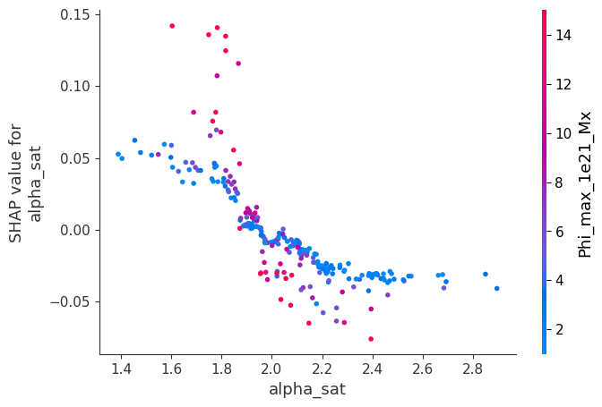
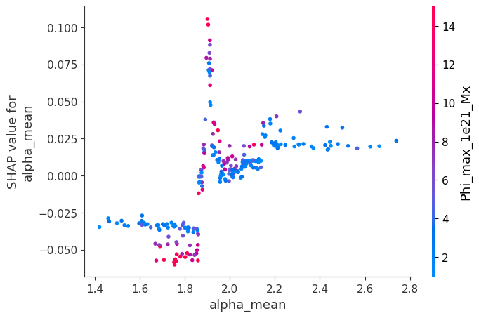
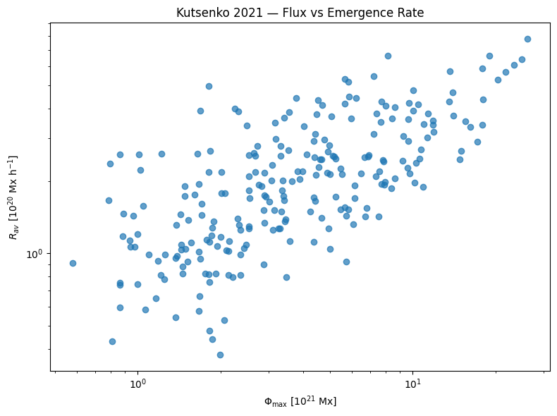

# Figures

These PNG figures were extracted directly from the executed Kaggle notebook
`notebooks/flare-ml-kutsenko-2019-2021.ipynb`.

They are preserved separately so GitHub visitors can inspect the principal
analysis visually without opening the notebook.

## Figure 01

**Notebook cell:** `10`

**Source operation:** `plt.figure(figsize=(8, 6))`

## Figure 02

**Notebook cell:** `24`

**Source operation:** `plt.figure(figsize=(8, 5))`

## Figure 03

**Notebook cell:** `37`

**Source operation:** `plt.figure(`

## Figure 04

**Notebook cell:** `38`

**Source operation:** `plot_data = flare_data[`

## Figure 05

**Notebook cell:** `55`

**Source operation:** `print(`

## Figure 06

**Notebook cell:** `59`

**Source operation:** `plot_phi = flare_reg[`

## Figure 07

**Notebook cell:** `60`

**Source operation:** `plot_phi = flare_reg[`

## Figure 08

**Notebook cell:** `68`

**Source operation:** `plt.figure(figsize=(9, 6))`

## Figure 09

**Notebook cell:** `69`

**Source operation:** `import shap`

## Figure 10

**Notebook cell:** `72`

**Source operation:** `shap.dependence_plot(`

## Figure 11

**Notebook cell:** `73`

**Source operation:** `shap.dependence_plot(`

## Figure 12

**Notebook cell:** `74`

**Source operation:** `shap.dependence_plot(`

## Figure 13

**Notebook cell:** `76`

**Source operation:** `plt.figure(figsize=(8, 6))`

> The most important figures from this gallery are also surfaced directly on the main repository README for portfolio/recruiter visibility.
